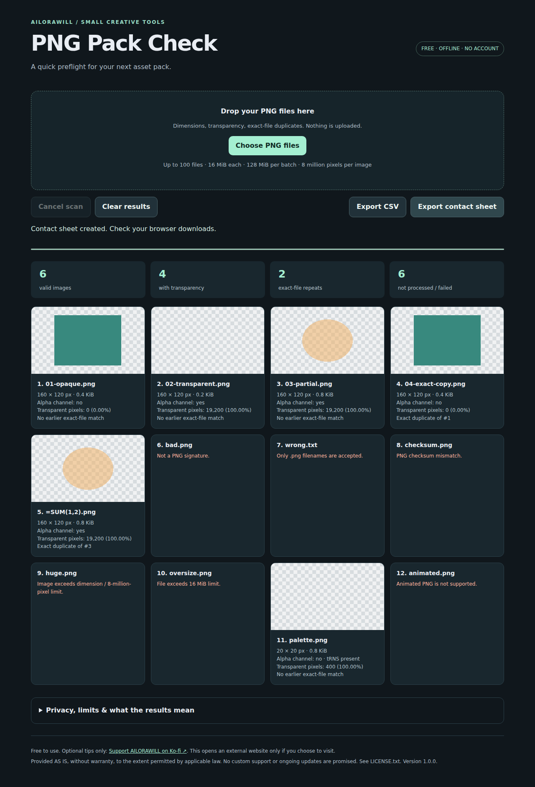

# PNG Pack Check 1.0.0

A free, offline preflight tool for small PNG asset packs. Optional tips only: https://ko-fi.com/ailorawill. This project is distributed free, with no paid tier or feature gates. Tips are voluntary and do not purchase support, updates or extra features. No account, payment, subscription, server, API key, installation, telemetry or network library is required.

## Use

1. Extract this ZIP. Open `index.html` in a modern desktop browser.
2. Choose or drop PNG files. Each selection replaces the previous batch.
3. Review dimensions, PNG alpha-channel/tRNS metadata, decoded transparent-pixel counts and exact-file repeats.
4. Export a CSV report or a PNG contact sheet. Exports are new downloads; originals are never changed. If your browser blocks a download, use its normal download permission controls.
5. Clear results or close the tab when finished.

The app reads selected files in memory only. It does not upload, delete or modify originals. The optional Ko-fi link opens an external site only when clicked. Exported filenames may be sensitive: review exports before sharing them.

## Results

- Exact duplicates are SHA-256 matches of the entire file, not visual similarity. Different metadata or compression can make visually identical files different.
- Alpha channel refers to the encoding. Transparent pixels means decoded alpha below 255, including partial transparency. PNG palette/tRNS is supported.
- PNG chunk CRCs and basic boundaries are checked before browser decoding. This is not a complete PNG conformance validator, color-proofing tool, malware scanner or metadata repair utility.
- Animated PNG is rejected. Browser-decoded pixel values are 8-bit; 16-bit source precision is not analyzed.
- Contact sheets show successful images, with numbered filename labels; long names may be shortened. CSV retains full filenames and includes failed-file errors.
- CSV fields are quoted. Values beginning with formula triggers (including leading whitespace) receive an apostrophe prefix. Spreadsheet behavior varies; import filename/text columns as text.

## Limits and cancellation

Maximum 100 files, 16 MiB per file, 128 MiB total selected bytes, 8,000,000 pixels and 8,192 pixels per edge. Count/total violations reject the entire new batch and preserve previous results. Individual file errors do not stop other files.

Files are processed sequentially. Full-size image canvases are released after each scan; only small previews and report data are retained. Checks and pixel scans yield at intervals. Cancel stops at the next checkpoint, but cannot interrupt a browser decode, SHA-256 operation or PNG encoding already in flight. Partial results can be exported. Limits reduce, but cannot guarantee against, memory exhaustion on every device.

## Verification status

On 2026-10-23, all 19 real-browser checks passed in Chromium 151.0.7922.34 on Linux, headless, opening the app directly from a local file with networking offline. Coverage includes real pixel transparency counts, duplicate hashes, corrupt/oversized/APNG rejection, CSV and contact-sheet downloads, cancellation/reselection, a four-million-pixel scan, and mobile-width overflow. No JavaScript errors or network requests were recorded. [Verified test run](https://github.com/willailora/png-pack-check/actions/runs/39911264499), tested commit `88d59b7f5ba52684cdcad40c2e5fab287f7ebd72`.

The 23 Node.js checks also passed: parser/header/CRC rejection, metadata, cancellation, count/byte/extension guards, CSV escaping, SHA-256 duplicate bookkeeping (decode stubbed in that suite) and static no-network checks. The source repository includes `qa/browser-manifest.json` and `qa/manifest.json` as separate evidence.

Firefox, Safari, native Windows use, real mobile hardware, low-memory hardware and every possible PNG encoding have not been tested. A mobile-sized Chromium viewport is not a mobile-device test. Spreadsheet-specific import behavior and full accessibility conformance are not certified. Passing these checks is not a warranty.

This genuine screenshot comes from the successful test run; the failed-file cards intentionally demonstrate rejection of invalid fixtures.

## Development checks

The [source repository](https://github.com/willailora/png-pack-check) contains editable source, test scripts and CI configuration. The small user download contains the app, this guide, license and screenshot; it does not require test dependencies.

For development, see `qa/BROWSER-CHECKS.md` in the source repository. Generate fixtures with `python qa/generate_fixtures.py`, then run `node qa/node-test.cjs`. With the documented Python dependencies and Chromium installed, run `python qa/test.py`; it writes a separate browser manifest only after all assertions pass. Test dependencies are development-only and are not needed to use the app.

## Source and terms

`index.html` contains all editable HTML, CSS and JavaScript. No build step. `LICENSE.txt` contains the MIT license. Provided AS IS, without warranty, to the extent permitted by applicable law. No custom support or ongoing updates are promised. This does not limit rights that applicable law does not allow to be waived.
